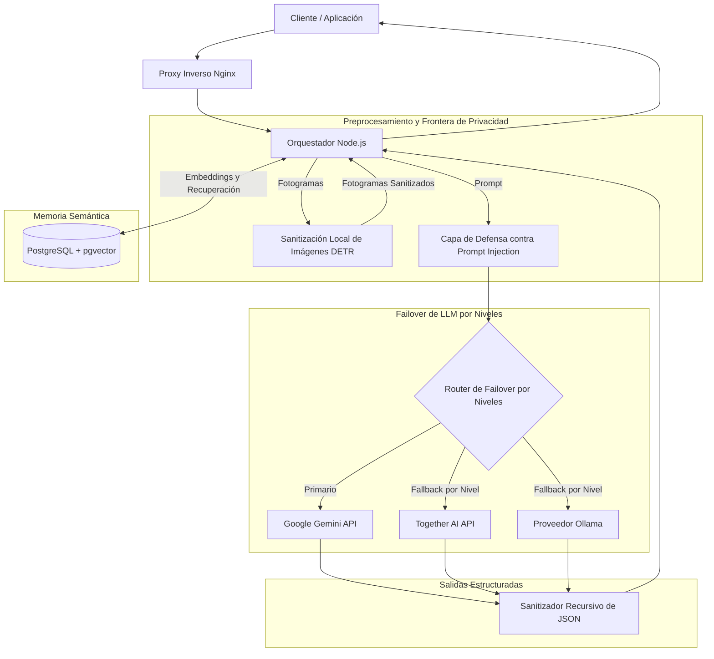

# Quiddit: Orquestación de IA Multi-Proveedor y Memoria Semántica a Largo Plazo

## Problema

Las aplicaciones de IA interactiva requieren retención de contexto y razonamiento resiliente a lo largo del ciclo conversacional. Depender de un único proveedor de IA introduce riesgos de interrupción del servicio, límites de peticiones (rate limits) y dependencia de un solo proveedor. Además, reenviar imágenes de usuarios sin filtrar y prompts sin restricciones a APIs externas genera riesgos de privacidad y posibles vulnerabilidades de inyección de prompts.

Quiddit es un orquestador de IA (~60k LOC) diseñado para gestionar el enrutamiento entre múltiples modelos, mantener memoria semántica a largo plazo y aplicar protecciones de privacidad locales.

---

## Restricciones

1. **Resiliencia ante Proveedores**: El sistema busca mitigar interrupciones por degradación de proveedores externos mediante failover entre proveedores cloud y modelos locales.
2. **Persistencia de Contexto**: El historial de diálogo debe indexarse y recuperarse semánticamente en lugar de saturar la ventana de contexto del prompt.
3. **Privacidad de Datos**: Las imágenes que contengan personas deben filtrarse localmente antes de que los fotogramas salgan de la frontera de red.
4. **Defensa de Entradas**: Los prompts de texto no confiables deben aislarse para resistir técnicas de prompt injection y proteger las directivas del sistema.
5. **Salidas Estructuradas**: Los servicios downstream del backend demandan respuestas en formato JSON estrictamente tipadas.

---

## Arquitectura

El siguiente diagrama detalla la arquitectura de componentes y el flujo de datos del orquestador Quiddit:

---

## Decisiones Clave y Trade-offs

- **PostgreSQL + pgvector para Memoria a Largo Plazo**:
  - *Decisión*: Se utilizó PostgreSQL con la extensión `pgvector` para alojar datos conversacionales, metadatos relacionales y embeddings vectoriales en una única base de datos.
  - *Trade-off*: Evita operar un cluster de base de datos vectorial separado, demandando una adecuada gestión de índices dentro de PostgreSQL.
- **Failover de LLM por Niveles**:
  - *Decisión*: Se configuraron cadenas de failover ordenadas según el nivel de cada tarea — Gemini como primario, con Together AI y modelos locales en Ollama como alternativas de contingencia según el nivel.
  - *Trade-off*: Demanda mantener compatibilidad de prompts entre diferentes familias de modelos, aportando resiliencia frente a caídas de un único proveedor.
- **Sanitización Local de Imágenes con DETR**:
  - *Decisión*: Se integró el modelo DETR (DEtection TRansformer) a nivel local para detectar y remover personas de las imágenes antes de su egreso a la red externa.
  - *Trade-off*: Suma procesamiento computacional local antes de remitir peticiones, garantizando que los fotogramas con personas no abandonen la red local.
- **Salidas con Esquema JSON Estricto**:
  - *Decisión*: Se combinaron parámetros de esquemas estructurados con sanitización recursiva de JSON en Node.js para asegurar el formato esperado.
  - *Trade-off*: Puede requerir reintentos de consulta si un modelo pequeño produce JSON malformado, protegiendo los contratos de los servicios dependientes.

---

## Enfoque de Seguridad

- **Aislamiento con Delimitadores**: Las entradas no confiables del usuario y los contextos de memoria recuperados se envuelven en delimitadores explícitos entre corchetes, eliminando los delimitadores inyectados dentro del texto antes de armar el prompt para aislar las entradas no confiables de las instrucciones del sistema.
- **Sanitización Recursiva de JSON**: Las respuestas del modelo se analizan y limpian de forma recursiva para validar tipos y neutralizar estructuras anómalas antes de su uso.
- **Filtrado Local con DETR**: Los fotogramas se inspeccionan localmente para ofuscar personas identificables antes de que la información salga de la red.
- **Aislamiento de Perímetro**: La infraestructura se despliega en contenedores Docker comunicados detrás de un proxy inverso Nginx.

---

## Stack Tecnológico

- **Orquestador Backend**: Node.js, TypeScript (~60k LOC)
- **Base de Datos y Almacén Semántico**: PostgreSQL, `pgvector`
- **Visión y Filtrado**: DETR (DEtection TRansformer)
- **Proveedores de Modelos**: Google Gemini, Together AI, Ollama
- **Despliegue**: Docker, Nginx

---

## Qué Haría a Continuación

1. **Validación Incremental de Esquemas en Streaming**: Exploración futura: incorporar parsers de JSON en streaming para validar campos mientras se reciben tokens en tiempo real.
2. **Búsqueda Híbrida Semántica + Léxica (BM25)**: Exploración futura: evaluar la combinación de búsqueda full-text de PostgreSQL con similitud vectorial mediante Reciprocal Rank Fusion.
3. **Suite Automatizada de Red-Teaming**: Exploración futura: crear un entorno de pruebas para verificar las defensas frente a técnicas emergentes de inyección de prompts.
