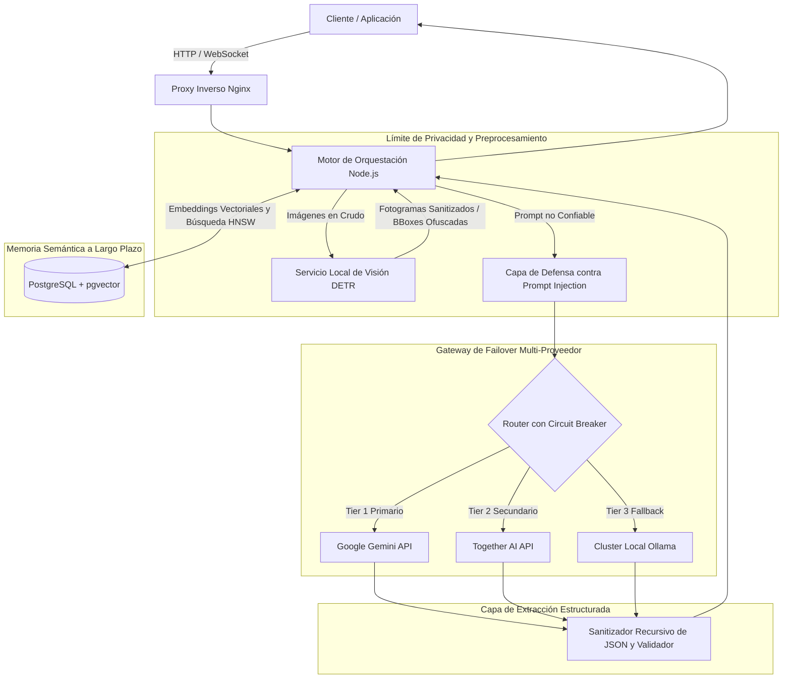

# Quiddit: Orquestación de IA Multi-Proveedor y Memoria Semántica a Largo Plazo

## Problema

Las aplicaciones modernas de IA interactiva demandan retención continua de contexto y razonamiento de baja latencia a lo largo de ciclos de conversación extensos. Depender de un único proveedor de IA introduce riesgos graves: caídas del servicio, límites de tasa (rate limits), picos de latencia y bloqueo de proveedor (vendor lock-in). Asimismo, enviar imágenes sin procesar y prompts sin restricciones a APIs externas genera exposiciones críticas de privacidad y vulnerabilidades ante ataques de prompt injection.

Quiddit fue concebido como un orquestador de IA de nivel de producción (~60.000 líneas de código) que provee enrutamiento resiliente entre múltiples modelos, memoria semántica duradera y protección proactiva de privacidad en el perímetro.

---

## Restricciones

1. **Resiliencia ante Proveedores y Disponibilidad**: El sistema debe tolerar la degradación o caída de APIs externas sin tiempo de inactividad, derivando dinámicamente el tráfico entre proveedores cloud y modelos auto-alojados.
2. **Persistencia de Contexto sin Saturación de Tokens**: Mantener historiales completos de conversación dentro de la ventana de contexto resulta inviable en costos y degrada la calidad del razonamiento. La recuperación de memoria debe ser veloz, relevante y acotada.
3. **Privacidad de Datos y Sanitización de Personas**: Las imágenes subidas por los usuarios jamás deben exponer sujetos humanos identificables a proveedores externos de LLM ni a redes públicas.
4. **Resistencia a Entradas Adversarias**: El texto libre ingresado por el usuario no debe poder secuestrar las instrucciones del sistema ni filtrar memorias conversacionales confidenciales.
5. **Determinismo para Consumidores Downstream**: Los sistemas de backend requieren respuestas en formato JSON estrictamente tipadas a partir de modelos cuyo comportamiento es probabilístico.

---

## Arquitectura

El siguiente diagrama detalla la arquitectura de componentes y el flujo de datos del orquestador Quiddit:

---

## Decisiones Clave y Trade-offs

- **PostgreSQL + pgvector frente a Bases de Datos Vectoriales Dedicadas**:
  - *Decisión*: Se utilizó PostgreSQL con `pgvector` para consolidar el estado conversacional relacional, los metadatos operativos y los embeddings semánticos en una única base de datos transaccional (ACID).
  - *Trade-off*: Se eliminó la sobrecarga operativa de sincronizar datos entre bases vectoriales especializadas (ej. Pinecone/Milvus) y bases relacionales, asumiendo una mayor gestión de índices en situaciones de alta concurrencia.
- **Failover Dinámico Multi-Proveedor (Gemini → Together AI → Ollama)**:
  - *Decisión*: Se implementó un esquema con health checks activos y circuit breakers que prioriza Gemini, conmuta a Together AI ante rate limits o picos de latencia, y delega en instancias locales de Ollama en casos extremos.
  - *Trade-off*: Requirió normalizar prompts entre modelos con distintas capacidades y ventanas de contexto, a cambio de una disponibilidad casi total.
- **Sanitización Local de Imágenes Basada en DETR**:
  - *Decisión*: Se integró un worker de visión que corre el modelo DEtection TRansformer (DETR) dentro del perímetro de infraestructura para detectar y ofuscar rostros y siluetas humanas antes de que las imágenes salgan de la red.
  - *Trade-off*: Añadió una pequeña penalización de latencia en la subida (~150–250 ms), garantizando la no filtración de datos biométricos o personales a APIs de terceros.
- **Validación Estricta de Esquemas JSON**:
  - *Decisión*: Se combinaron parámetros nativos de salida estructurada con sanitizadores recursivos en el backend para forzar la consistencia de los tipos.
  - *Trade-off*: Mayor necesidad de reintentos o correcciones sobre modelos de menor escala, protegiendo los contratos de datos con los servicios dependientes.

---

## Enfoque de Seguridad

- **Aislamiento Mediante Delimitadores XML**: Las entradas no confiables del usuario y los fragmentos históricos recuperados se encapsulan en etiquetas XML validadas criptográficamente, previniendo la inyección de directivas que alteren las instrucciones del sistema.
- **Sanitización Recursiva de JSON**: Las respuestas del modelo se procesan eliminando caracteres de control, verificando riesgos de polución de prototipos y validando esquemas contra contratos estrictos antes de impactar en base de datos.
- **Privacidad en el Perímetro Local**: Las imágenes que contienen personas son sanitizadas en la red interna mediante DETR; únicamente versiones ofuscadas son accesibles para procesamientos posteriores.
- **Credenciales Efímeras y Red Aislada**: Los microservicios operan en una red Docker privada detrás de Nginx; ninguna clave de API se expone al cliente ni reside fuera de las configuraciones de entorno seguras.

---

## Stack Tecnológico

- **Backend Runtime**: Node.js, TypeScript
- **Base de Datos y Memoria Semántica**: PostgreSQL, `pgvector`
- **Visión y Privacidad**: PyTorch, DETR (DEtection TRansformer)
- **Proveedores de Modelos**: Google Gemini API, Together AI API, Ollama (Auto-alojado)
- **Infraestructura y Despliegue**: Docker, Docker Compose, Nginx

---

## Qué Haría a Continuación

1. **Validación de Esquemas en Streaming**: Desarrollar parsers incrementales de JSON para validar y emitir fragmentos de datos a medida que se generan tokens, bajando la latencia percibida por el usuario.
2. **Búsqueda Híbrida Semántica + Léxica (BM25)**: Integrar búsqueda full-text de PostgreSQL con distancia coseno vectorial aplicando Reciprocal Rank Fusion (RRF) para mejorar la precisión en términos técnicos específicos.
3. **Pipeline de Red-Teaming Automatizado en CI**: Diseñar pruebas automáticas de evaluación adversaria para auditar de forma continua la efectividad de las defensas contra nuevas técnicas de jailbreak.
