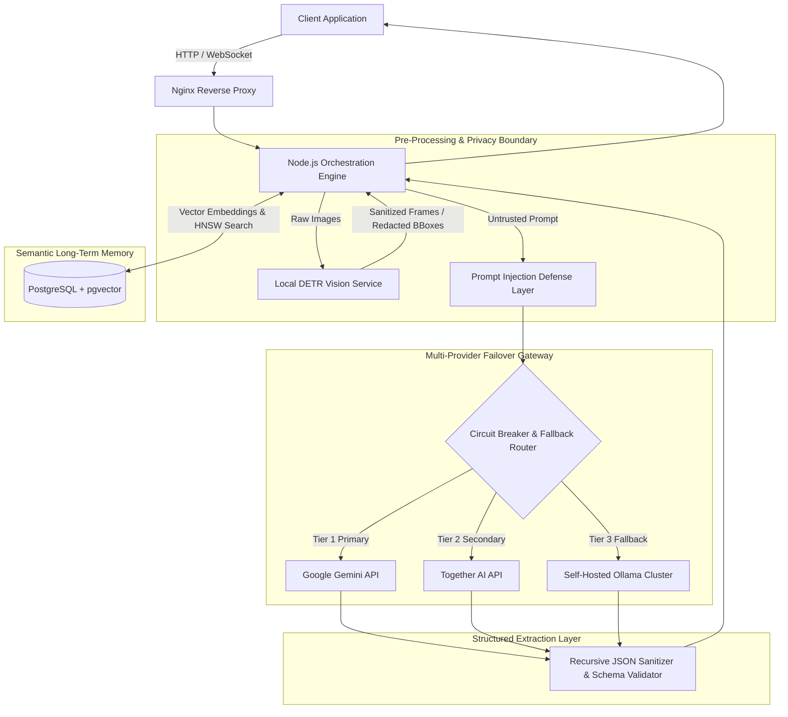

# Quiddit: Multi-Provider AI Orchestration & Long-Term Semantic Memory

## Problem

Modern interactive AI applications require continuous context retention and low-latency reasoning across extended conversational lifecycles. Relying on a single proprietary AI provider introduces severe risks: service outages, rate limits, latency spikes, and vendor lock-in. Furthermore, sending raw user-submitted images and unconstrained prompts to external inference APIs creates critical privacy exposures and prompt-injection vulnerabilities.

Quiddit was designed as a production-grade AI orchestrator (~60,000 lines of code) that provides resilient multi-model routing, durable long-term semantic memory, and proactive edge privacy protections.

---

## Constraints

1. **Vendor Resilience & Uptime**: The system must sustain zero downtime during upstream provider degradation or API outages by dynamically falling back across heterogeneous cloud and self-hosted model backends.
2. **Context Persistence Without Token Saturation**: Retaining complete multi-turn dialogue histories in raw token context windows is cost-prohibitive and degrades reasoning performance. Memory recall must be fast, relevant, and bounded.
3. **Data Privacy & Zero-Egress Person Scrubbing**: User-uploaded imagery must never expose identifiable human subjects to external LLM providers or unencrypted networks.
4. **Adversarial Input Resilience**: Free-form text prompts must not hijack system instructions or extract sensitive conversational memory.
5. **Deterministic Downstream Consumers**: Core business systems require strictly typed JSON responses from model outputs that are inherently probabilistic.

---

## Architecture

The following diagram illustrates the component architecture and data flow of the Quiddit orchestrator:

---

## Key Decisions & Trade-offs

- **PostgreSQL + pgvector over Specialized Vector Databases**:
  - *Decision*: Adopted PostgreSQL with `pgvector` to consolidate relational conversational state, operational metadata, and high-dimensional semantic embeddings within a single ACID-compliant database.
  - *Trade-off*: Avoided the operational burden of synchronizing data between separate vector engines (e.g., Pinecone/Milvus) and standard relational databases, accepting slightly higher indexing management overhead under high concurrency.
- **Dynamic Multi-Provider Fallback (Gemini → Together AI → Ollama)**:
  - *Decision*: Built an active health-checking and circuit-breaker mechanism that routes requests primarily to Gemini, cascades to Together AI upon rate-limiting or latency thresholds, and ultimately falls back to self-hosted Ollama instances.
  - *Trade-off*: Required maintaining prompt normalization and capability parity across models with varying context sizes, but delivered near-100% availability.
- **Local DETR-based Image Scrubbing**:
  - *Decision*: Integrated a local vision worker utilizing the DEtection TRansformer (DETR) model running inside the infrastructure perimeter to locate and redact human faces/bodies before frames exit the boundary.
  - *Trade-off*: Introduced a minimal edge-processing latency penalty per image upload (~150–250 ms), completely eliminating the risk of external PII leakage.
- **Strict JSON-Schema Output Enforcement**:
  - *Decision*: Combined native schema enforcement parameters with post-generation JSON sanitization to guarantee conformant structural data.
  - *Trade-off*: Occasional re-prompt or schema repair overhead on lower-parameter fallback models, in exchange for zero contract breaks in downstream application services.

---

## Security Approach

- **XML Delimiter Isolation**: Untrusted user inputs and historical context fragments are wrapped inside cryptographically validated XML tags with explicit boundary directives, preventing the LLM from executing injected system prompts.
- **Recursive JSON Sanitization**: Model outputs are recursively parsed, stripped of control characters, checked for prototype pollution attacks, and validated against strict schemas before memory storage or execution.
- **Local Perimeter Privacy**: Raw image frames containing human subjects are processed through the DETR scrubbing service; only obscured or redacted image representations leave the local Docker network.
- **Ephemeral Credentials & Network Isolation**: Services communicate inside an internal Docker network behind Nginx; all provider API keys reside strictly within encrypted environment runtime configs.

---

## Stack

- **Backend Runtime**: Node.js, TypeScript
- **Database & Semantic Store**: PostgreSQL, `pgvector`
- **Vision & Privacy**: PyTorch, DETR (DEtection TRansformer)
- **Model Providers**: Google Gemini API, Together AI API, Ollama (Self-Hosted)
- **Infrastructure & Deployment**: Docker, Docker Compose, Nginx

---

## What I'd Do Next

1. **Streaming Partial Schema Validation**: Implement incremental streaming JSON parsers to validate and emit structured fields as tokens arrive, reducing perceived user latency.
2. **Hybrid Semantic + BM25 Lexical Retrieval**: Introduce PostgreSQL full-text search fused with vector cosine distance using Reciprocal Rank Fusion (RRF) for enhanced domain keyword precision.
3. **Automated Red-Teaming CI Suite**: Build a synthetic adversarial evaluation harness in CI to continuously benchmark prompt injection defenses against updated jailbreak vectors.
