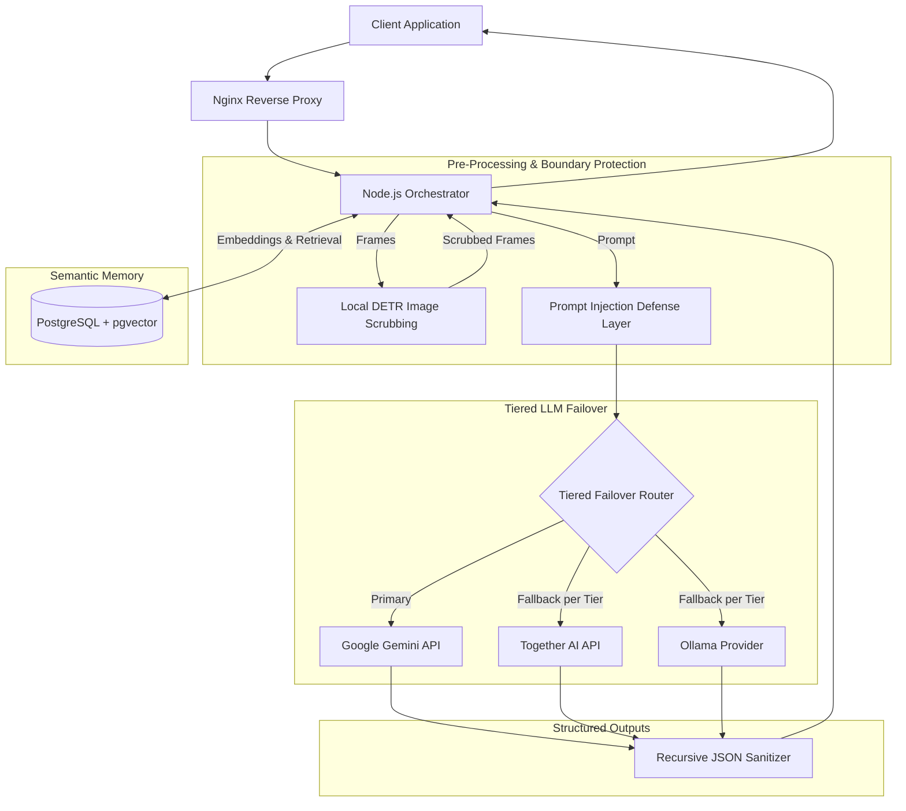

# Quiddit: Multi-Provider AI Orchestration & Long-Term Semantic Memory

## Problem

Interactive AI applications require context retention and resilient reasoning across conversational lifecycles. Relying on a single proprietary AI provider introduces risks of service interruptions, rate limiting, and vendor dependence. Furthermore, forwarding unscrubbed user-submitted images and unconstrained prompts to external inference APIs creates privacy risks and potential prompt-injection vulnerabilities.

Quiddit is an AI orchestrator (~60k LOC) designed to manage multi-model routing, maintain long-term semantic memory, and apply local privacy protections.

---

## Constraints

1. **Vendor Resilience**: The system is designed to mitigate downtime from upstream provider degradation by supporting failover across cloud and local model providers.
2. **Context Persistence**: Dialogue histories must be indexed and retrieved semantically rather than overloading prompt context windows.
3. **Data Privacy**: Images containing human subjects must be scrubbed locally before frames leave the network boundary.
4. **Input Defense**: Untrusted text prompts must be isolated to resist prompt injection and protect system instructions.
5. **Structured Outputs**: Core downstream services require strictly typed JSON responses from model outputs.

---

## Architecture

The following diagram illustrates the component architecture and data flow of the Quiddit orchestrator:

---

## Key Decisions & Trade-offs

- **PostgreSQL + pgvector for Long-Term Memory**:
  - *Decision*: Adopted PostgreSQL with `pgvector` to store conversational data, relational metadata, and vector embeddings in a unified database.
  - *Trade-off*: Avoids maintaining a separate vector database cluster alongside relational storage, while requiring appropriate index management in PostgreSQL.
- **Tiered LLM Failover**:
  - *Decision*: Configured ordered failover chains per task tier — Gemini as primary, with Together AI and local Ollama models as fallbacks depending on the tier.
  - *Trade-off*: Requires maintaining prompt compatibility across distinct model families, but provides resilience against single-vendor outages.
- **Local DETR-Based Image Scrubbing**:
  - *Decision*: Integrated an on-premises DETR (DEtection TRansformer) model to detect and scrub people from image frames locally before any network egress.
  - *Trade-off*: Incurs local compute overhead before forwarding requests, but ensures frames with people do not leave the local network.
- **Strict JSON-Schema Output Enforcement**:
  - *Decision*: Combined model-level schema constraints with recursive JSON sanitization in Node.js to enforce expected data structures.
  - *Trade-off*: May require fallback re-prompting if a smaller model returns malformed JSON, but protects downstream application contracts.

---

## Security Approach

- **Delimiter Isolation**: Untrusted user input and retrieved memory contexts are wrapped in explicit bracketed delimiter markers, and delimiter markers injected inside the input are stripped before prompting to isolate untrusted input from system instructions.
- **Recursive JSON Sanitization**: Model responses are recursively parsed and sanitized to validate types and mitigate malformed payloads before processing.
- **Local DETR Scrubbing**: Image frames are evaluated locally; identifiable people are scrubbed before frames leave the network.
- **Perimeter Isolation**: Components are deployed within Docker containers behind an Nginx reverse proxy.

---

## Stack

- **Backend Orchestrator**: Node.js, TypeScript (~60k LOC)
- **Database & Semantic Store**: PostgreSQL, `pgvector`
- **Vision & Scrubbing**: DETR (DEtection TRansformer)
- **Model Providers**: Google Gemini, Together AI, Ollama
- **Deployment**: Docker, Nginx

---

## What I'd Do Next

1. **Streaming Partial Schema Validation**: Future exploration: implement incremental streaming JSON parsing to validate fields as tokens arrive.
2. **Hybrid Semantic + BM25 Lexical Retrieval**: Future exploration: evaluate combining PostgreSQL full-text search with vector similarity using Reciprocal Rank Fusion.
3. **Automated Red-Teaming Suite**: Future exploration: build an automated test harness to evaluate injection defense boundaries against emerging jailbreak techniques.
