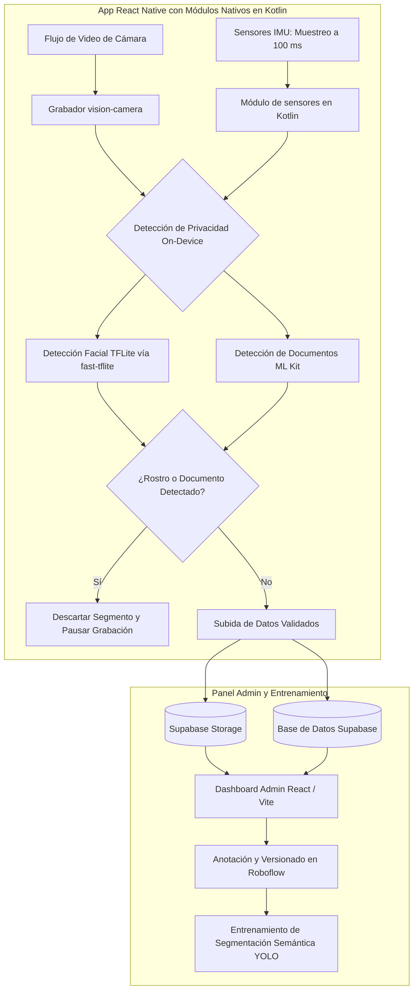

# Qvision: Captura Edge de Video y Sensores en Tiempo Real

## Problema

La construcción de datasets para visión computacional requiere recopilar video de cámara sincronizado con lecturas de sensores de unidad de medición inercial (IMU) en dispositivos móviles. Los frameworks móviles convencionales pueden experimentar dificultades para coordinar fotogramas de video con marcas de tiempo de sensores bajo cargas intensivas de procesamiento. A su vez, la grabación de video en entornos reales conlleva el riesgo de capturar rostros de transeúntes o documentos personales, demandando filtros de privacidad inmediatos.

Qvision fue diseñado como una plataforma de recolección en el edge y validación de datasets (~55k LOC) combinando sincronización de sensores móviles, disparadores de privacidad on-device y un panel web de administración.

---

## Restricciones

1. **Sincronización de Sensores**: La captura de video debe combinarse con telemetría continua de IMU muestreada a intervalos de 100 ms en el dispositivo móvil.
2. **Disparadores de Privacidad On-Device**: La detección facial y la detección de documentos deben evaluar los fotogramas directamente en el dispositivo; si se detecta un rostro o un documento, la app debe descartar el segmento y pausar la grabación.
3. **Flujo de Validación de Datasets**: La información recopilada requiere revisión administrativa, anotación y reentrenamiento para modelos de segmentación semántica.

---

## Arquitectura

El siguiente diagrama detalla la captura en el edge móvil, el filtrado de privacidad y el pipeline de administración de datasets:

---

## Decisiones Clave y Trade-offs

- **App React Native con Módulos Nativos en Kotlin**:
  - *Decisión*: Se desarrolló la interfaz de la aplicación en React Native utilizando `react-native-vision-camera` para la grabación de video, complementada con módulos nativos en Kotlin para el registro de sensores IMU a 100 ms, escaneo de documentos con ML Kit, escritura de archivos y reproducción de video.
  - *Trade-off*: Suma mantenimiento en las fronteras del puente de React Native, permitiendo control nativo de hilos para sostener la telemetría periódica a 100 ms mientras se delega la grabación intensiva de video en herramientas de cámara dedicadas.
- **Descarte de Privacidad On-Device (Fast-TFLite y ML Kit)**:
  - *Decisión*: Se incorporó detección facial con TFLite mediante `react-native-fast-tflite` y escaneo de documentos con ML Kit en el dispositivo. Al detectarse un rostro o documento, el segmento actual se descarta y la grabación se pausa.
  - *Trade-off*: Puede descartar segmentos que contengan partes útiles no sensibles, impidiendo que material con rostros o documentos avance hacia la etapa de subida.
- **Panel Administrativo en React / Vite / Supabase**:
  - *Decisión*: Se construyó una aplicación web de validación de datos usando React y Vite, respaldada por Supabase para almacenamiento y base de datos.
  - *Trade-off*: Aprovechó funcionalidades integradas del backend para acelerar las herramientas de administración, concentrando el desarrollo en los flujos de revisión de datasets.
- **Roboflow para Anotación y Segmentación Semántica con YOLO**:
  - *Decisión*: Se utilizó Roboflow para la anotación y versionado de datos, entrenando modelos YOLO orientados a tareas de segmentación semántica.
  - *Trade-off*: Genera dependencia de herramientas externas de anotación, facilitando un pipeline claro desde datasets validados hasta el entrenamiento de segmentación semántica.

---

## Enfoque de Seguridad

- **Compuerta Inmediata en el Dispositivo**: Los segmentos que contienen rostros o documentos detectados se descartan en el propio dispositivo, pausando la captura antes de cualquier transmisión de red.
- **Controles de Acceso en Supabase**: Las tablas y buckets de almacenamiento se administran con políticas de control de acceso y roles autenticados.
- **Minimización de Datos de Privacidad**: Los modelos de detección en el móvil operan como disparadores lógicos binarios sin almacenar identidades biométricas ni textos extraídos.

---

## Stack Tecnológico

- **Aplicación Móvil**: React Native, `react-native-vision-camera`, `react-native-fast-tflite`, módulos nativos en Kotlin (~55k LOC en la plataforma)
- **Modelos de Visión On-Device**: TensorFlow Lite vía `react-native-fast-tflite` (Detección Facial), Google ML Kit (Detección de Documentos)
- **Panel Administrativo**: React, Vite
- **Backend y Almacenamiento**: Supabase (Base de Datos, Object Storage)
- **Anotación y Modelos**: Roboflow, YOLO (Segmentación Semántica)

---

## Qué Haría a Continuación

1. **Implementación Nativa en C++ con NDK**: Idea a futuro: evaluar la implementación del buffer de sincronización cámara-IMU directamente en C++ a través del NDK de Android.
2. **Rutinas de Calibración de Sensores**: Idea a futuro: investigar rutinas on-device para contrastar la deriva de sensores IMU frente al desplazamiento óptico.
3. **Inpainting Selectivo**: Idea a futuro: explorar técnicas de inpainting ligero en el edge para desenfocar rostros de fondo sin requerir el descarte completo de los segmentos.
