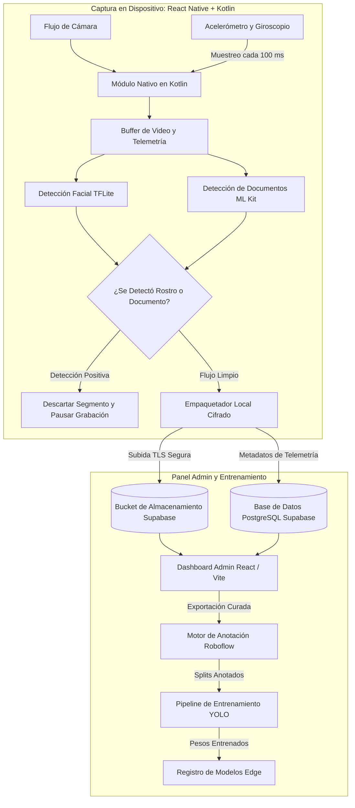

# Qvision: Captura Edge de Video y Sensores en Tiempo Real

## Problema

La creación de datasets de alta precisión para visión computacional y computación espacial exige sincronizar flujos de video de alta tasa de cuadros con telemetría de unidades de medición inercial (IMU) en dispositivos móviles. Los frameworks móviles estándar frecuentemente introducen bloqueos en hilos de ejecución, pérdida de cuadros y desfasajes temporales entre las marcas de tiempo de los sensores y el video. A su vez, los videos capturados en exteriores captan de forma involuntaria rostros de transeúntes y documentos personales, originando riesgos regulatorios y de privacidad si se almacenan directamente en la nube.

Qvision fue diseñado como una plataforma integral de adquisición y curaduría de datasets (~55.000 líneas de código) que combina sincronización de sensores a alta frecuencia, filtros de privacidad on-device y un panel administrativo seguro para validación.

---

## Restricciones

1. **Sincronización Estricta de Telemetría a 100 ms**: Las lecturas del acelerómetro y giroscopio deben tomarse con precisión cada 100 ms y asociarse a los fotogramas de video correspondientes sin pérdidas de cuadros ante alta carga de CPU.
2. **Privacidad Total en el Edge**: Cualquier segmento que capture rostros humanos o documentos de identidad debe detectarse en el propio dispositivo; el segmento no conforme se descarta en memoria antes de cualquier intento de subida.
3. **Restricciones de Hardware y Batería**: Los modelos de machine learning que analizan la privacidad deben ejecutarse en tiempo real sobre el hardware móvil sin inducir sobrecalentamiento ni agotamiento acelerado de batería.
4. **Integridad y Curación de Datos**: La información recolectada requiere revisión humana, anotación automática de cuadros delimitadores y ciclos continuos de reentrenamiento de modelos de segmentación.

---

## Arquitectura

El siguiente diagrama ilustra el flujo completo de captura, filtrado de privacidad y curaduría en Qvision:

---

## Decisiones Clave y Trade-offs

- **Interfaz en React Native Integrada a Módulos Nativos en Kotlin**:
  - *Decisión*: Se estructuró la aplicación en React Native para iterar rápidamente sobre la interfaz gráfica, mientras que el pipeline de video y el muestreo de sensores IMU a 100 ms se implementaron en módulos nativos en Kotlin ejecutándose en hilos dedicados.
  - *Trade-off*: Mayor complejidad en el puente nativo (bridge/JSI), garantizando cero desfasaje temporal y evitando retrasos del bucle de eventos de JavaScript.
- **Descarte Inmediato en el Edge frente a Redacción en la Nube**:
  - *Decisión*: Si el detector facial TFLite o el detector de documentos ML Kit disparan una coincidencia, el segmento completo se purga de la memoria del teléfono y la grabación se pausa.
  - *Trade-off*: Se descartan cuadros útiles circundantes dentro de ese bloque, pero se asegura cumplimiento regulatorio absoluto sin que información sensible salga del dispositivo.
- **Supabase para Validación de Datos y Metadatos**:
  - *Decisión*: Se utilizó Supabase (PostgreSQL, Storage y Auth) con políticas de Row-Level Security (RLS) para centralizar la ingesta y la revisión del equipo curador.
  - *Trade-off*: Mayor velocidad de desarrollo al contar con autenticación y gestión de archivos integradas, permitiendo enfocar los recursos en la validación del dataset.
- **Roboflow + YOLO para Anotación y Entrenamiento**:
  - *Decisión*: Se conectó Roboflow para el etiquetado asistido y control de versiones del dataset, exportando particiones directas para el entrenamiento de modelos de segmentación YOLO.
  - *Trade-off*: Dependencia de herramientas externas de etiquetado, optimizando drásticamente los tiempos de iteración entre la recolección y la puesta en producción de nuevos modelos.

---

## Enfoque de Seguridad

- **Aislamiento Volátil de Datos**: Los buffers de video residen en memoria volátil y solo se escriben en almacenamiento persistente una vez que los clasificadores de privacidad confirman la ausencia de personas y documentos.
- **Row-Level Security (RLS) Estricto**: Las tablas y buckets en Supabase imponen políticas RLS intransigentes, garantizando que los usuarios solo puedan escribir en sus rutas de subida asignadas sin visibilidad sobre otros flujos.
- **Cero Retención de PII en Crudo**: Ni las características faciales ni los textos detectados por OCR se almacenan o transmiten; los modelos on-device operan puramente como compuertas lógicas booleanas.
- **URLs de Subida Firmadas**: El transporte de datos se realiza mediante credenciales de subida prefirmadas de vida corta emitidas tras verificar la sesión del recolector.

---

## Stack Tecnológico

- **Cliente Móvil**: React Native, Kotlin (Módulos Nativos Android)
- **ML en el Dispositivo**: TensorFlow Lite (Detección Facial), Google ML Kit (Detección de Documentos)
- **Panel Administrativo**: React, Vite, TypeScript, Tailwind CSS
- **Backend y Almacenamiento**: Supabase (PostgreSQL, Row-Level Security, Object Storage)
- **Anotación y Entrenamiento**: Roboflow, Ultralytics YOLO (Segmentación de Instancias)

---

## Qué Haría a Continuación

1. **Ring Buffer Nativo en C++ con NDK**: Migrar la sincronización de fotogramas a C++ mediante el NDK de Android para posibilitar transferencias de memoria zero-copy entre la cámara y la inferencia de modelos.
2. **Calibración Activa con Filtro de Kalman**: Incorporar un Filtro de Kalman Extendido (EKF) on-device para fusionar lecturas inerciales con vectores de flujo óptico en tiempo real.
3. **Inpainting Focalizado en el Edge**: Entrenar un modelo ligero de inpainting on-device que permita ofuscar rostros lejanos en segundo plano sin requerir descartar el segmento por completo.
