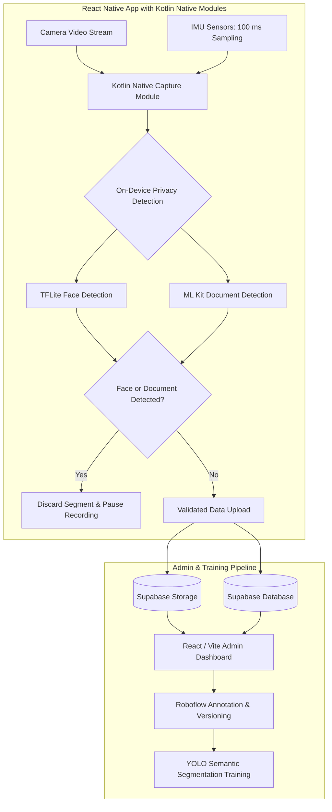

# Qvision: Real-Time Edge Video & Sensor Capture Platform

## Problem

Building datasets for computer vision requires collecting synchronized camera video alongside inertial measurement unit (IMU) sensor readings on mobile devices. Standard mobile frameworks can struggle to coordinate camera frames with sensor timestamps under intensive processing workloads. In addition, mobile video recording in field environments risks capturing bystanders' faces or personal documents, requiring immediate privacy filtering.

Qvision was architected as an edge collection and dataset validation platform (~55k LOC) combining mobile sensor synchronization with on-device privacy tripwires and a web administration panel.

---

## Constraints

1. **Sensor Synchronization**: Video capture must be paired with continuous IMU telemetry sampled at 100 ms intervals on the mobile device.
2. **On-Device Privacy Tripwires**: Face detection and document detection must evaluate incoming frames directly on the device; if a face or document is detected, the app must discard the segment and pause recording.
3. **Dataset Validation Workflow**: Ingested data requires administrative review, annotation, and retraining for semantic segmentation models.

---

## Architecture

The following diagram illustrates the mobile edge capture, privacy filtering, and dataset administration pipeline:

---

## Key Decisions & Trade-offs

- **React Native App with Kotlin Native Modules**:
  - *Decision*: Implemented the application shell in React Native while building native Kotlin modules to handle video capture and 100 ms IMU sensor polling.
  - *Trade-off*: Adds maintenance across React Native bridge boundaries, but allows native threading control for consistent 100 ms sensor telemetry.
- **On-Device Privacy Discard (TFLite & ML Kit)**:
  - *Decision*: Deployed on-device TFLite face detection and ML Kit document detection. When a face or document is detected, the current segment is discarded and recording is paused.
  - *Trade-off*: May discard segments that contain usable non-sensitive footage, but prevents footage with faces or documents from progressing to upload.
- **React / Vite / Supabase Admin Panel**:
  - *Decision*: Built a dataset validation web application using React and Vite, backed by Supabase for storage and data management.
  - *Trade-off*: Leveraged ready-to-use backend capabilities to accelerate administration tools, keeping focus on dataset review workflows.
- **Roboflow for Annotation and YOLO Semantic Segmentation**:
  - *Decision*: Utilized Roboflow for dataset annotation and version control, training YOLO models for semantic segmentation tasks.
  - *Trade-off*: Relies on external annotation tooling, while providing a clear pipeline from validated datasets to semantic segmentation training.

---

## Security Approach

- **Immediate On-Device Gating**: Segments containing detected faces or documents are discarded on-device, pausing recording before any network transmission occurs.
- **Supabase Access Controls**: Data access and storage buckets are configured with backend access controls and authenticated management roles.
- **Privacy Minimization**: Privacy detection models on mobile act as binary tripwires rather than storing facial recognition or extracted OCR data.

---

## Stack

- **Mobile App**: React Native, Kotlin native modules (~55k LOC across platform)
- **On-Device Vision Models**: TensorFlow Lite (Face Detection), Google ML Kit (Document Detection)
- **Admin Dashboard**: React, Vite
- **Backend & Storage**: Supabase (Database, Object Storage)
- **Annotation & Model Training**: Roboflow, YOLO (Semantic Segmentation)

---

## What I'd Do Next

1. **Native NDK Implementation**: Future idea: evaluate writing the camera-IMU synchronization buffer directly in C++ via the Android NDK.
2. **Sensor Calibration Routines**: Future idea: investigate on-device routines to cross-validate IMU sensor drift against optical movement.
3. **Selective Inpainting**: Future idea: research edge inpainting techniques that could blur background faces without needing to discard entire video segments.
