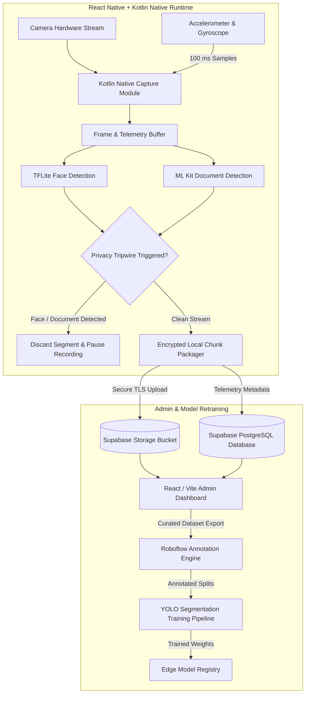

# Qvision: Real-Time Edge Video & Sensor Capture Platform

## Problem

Building spatial computing and high-precision computer vision datasets requires synchronizing high-framerate camera streams with inertial measurement unit (IMU) telemetry on mobile hardware. Standard mobile application frameworks often introduce thread contention, frame drops, and clock drift between sensor timestamps and video frames. Concurrently, crowdsourced or edge-collected video feeds frequently capture bystanders' faces and personal documents, creating serious regulatory and ethical liabilities if uploaded to centralized cloud storage.

Qvision was architected as an edge collection and dataset management platform (~55,000 lines of code) combining high-frequency mobile sensor synchronization, on-device privacy tripwires, and a secure validation backoffice.

---

## Constraints

1. **Strict 100 ms Telemetry Synchronization**: Accelerometer and gyroscope readings must sample reliably at 100 ms intervals and pair deterministically with corresponding video frames without dropping frames under CPU pressure.
2. **Zero-Leak Edge Privacy**: Videos containing human faces or sensitive identity documents must be caught immediately at the capture edge; non-compliant segments must be discarded on-device before any network upload occurs.
3. **Hardware & Battery Constraints**: On-device machine learning models for privacy detection must run in real time on mobile chipsets without causing thermal throttling or excessive battery drain.
4. **Dataset Integrity & Curation**: Raw ingested data requires human-in-the-loop review, automated bounding box annotation, and model retraining cycles for object segmentation.

---

## Architecture

The following diagram illustrates the end-to-end data acquisition, privacy gating, and curation pipeline of Qvision:

---

## Key Decisions & Trade-offs

- **React Native UI Coupled to Kotlin Native Modules**:
  - *Decision*: Built the application shell in React Native for rapid cross-platform UI iteration, while delegating video pipeline handling and 100 ms IMU sensor polling directly to low-level Kotlin native modules using dedicated background threads.
  - *Trade-off*: Increased integration complexity across the React Native JSI/bridge layer, but avoided JavaScript event loop lag and ensured zero jitter in sensor synchronization.
- **Immediate Edge Discard vs. Cloud Redaction**:
  - *Decision*: When the on-device TFLite face detector or ML Kit document detector identifies sensitive content, the entire segment is instantly dropped from memory and recording pauses.
  - *Trade-off*: Forfeited potentially salvageable non-sensitive frames within that segment, but achieved absolute regulatory compliance with zero PII leaving user devices.
- **Supabase for Dataset Validation & Metadata Operations**:
  - *Decision*: Utilized Supabase (PostgreSQL, Storage, Auth) with Row-Level Security for the data ingestion and reviewer administration dashboard.
  - *Trade-off*: Leveraged ready-to-use authentication and storage synchronization to keep engineering velocity high for dataset curators.
- **Roboflow + YOLO for Annotation & Training**:
  - *Decision*: Integrated Roboflow for semi-automated dataset labeling and dataset version control, exporting directly to YOLO instance segmentation models.
  - *Trade-off*: Maintained an external tool dependency for annotation, but expedited the cycle from edge capture to newly deployed edge models.

---

## Security Approach

- **On-Device Data Quarantine**: Frame buffers remain in volatile memory and are committed to persistent disk only once privacy classifiers confirm absence of faces and documents.
- **Strict Row-Level Security (RLS)**: Data submission endpoints and Supabase storage buckets enforce RLS policies, ensuring contributors can only write to dedicated ingest paths and cannot inspect other upload streams.
- **Zero Raw PII Storage**: Neither facial embeddings nor document OCR text are persisted or transmitted; the edge models act purely as boolean gating mechanisms.
- **Signed Upload Credentials**: Ingest uploads use short-lived, pre-signed upload URLs generated through backend authentication policies.

---

## Stack

- **Mobile Client**: React Native, Kotlin (Android Native Modules)
- **On-Device ML**: TensorFlow Lite (Face Detection), Google ML Kit (Document Detection)
- **Admin Dashboard**: React, Vite, TypeScript, Tailwind CSS
- **Backend & Storage**: Supabase (PostgreSQL, Row-Level Security, Object Storage)
- **Annotation & Vision Training**: Roboflow, Ultralytics YOLO (Instance Segmentation)

---

## What I'd Do Next

1. **Native NDK C++ Video Ring Buffer**: Migrate the frame synchronization layer to C++ via Android NDK for zero-copy memory transfers between the camera HAL and model inference runtimes.
2. **Active Drift Calibration**: Implement an Extended Kalman Filter (EKF) on-device to dynamically fuse accelerometer and gyroscope readings against optical flow vectors in real time.
3. **Automated Segment Healing**: Train an ultra-compact edge inpainting model to redact isolated small background faces without requiring full segment discard.
