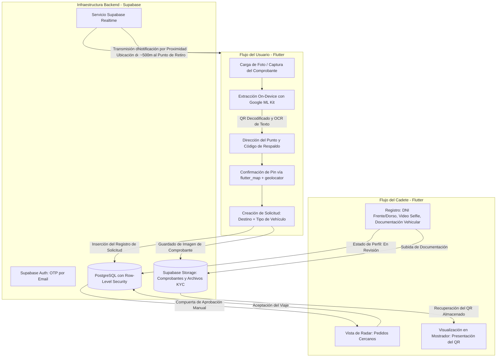

# umi: Delegación de retiros de última milla

## Problema

Las entregas de comercio electrónico derivan frecuentemente los paquetes a puntos de retiro de paquetería en lugar de domicilios particulares. Para los usuarios que no pueden retirar sus pedidos personalmente, coordinar el retiro a través de un tercero exige delegar la autorización correspondiente. Los servicios habituales de mensajería o viajes urbanos funcionan como redes genéricas de transporte de punto a punto y carecen de los controles de identidad y los mecanismos de autorización necesarios para retirar encomiendas custodiadas en nombre del destinatario.

umi fue desarrollado como un MVP en Flutter (con enfoque inicial en Android para pruebas cerradas) diseñado como un puente seguro de autorización con cadena de custodia para la delegación de retiros de última milla, permitiendo delegar el retiro en puntos de entrega de e-commerce a cadetes verificados.

---

## Restricciones

1. **Foco en Puente de Autorización**: La aplicación se posiciona estrictamente como un puente seguro de autorización con cadena de custodia, y no como un servicio de transporte genérico de punto A a punto B.
2. **Extracción de Comprobantes On-Device**: La decodificación del código QR y la extracción de texto a partir de imágenes cargadas por el usuario deben ejecutarse directamente en el dispositivo, sin llamadas a servicios externos de visión.
3. **Validación Rigurosa de Cadetes**: Las cuentas de cadetes deben superar una verificación de identidad y documentación antes de poder visualizar o aceptar solicitudes de retiro.
4. **Despliegue Focalizado**: MVP móvil desarrollado con prioridad en Android para entornos de pruebas cerradas.

---

## Arquitectura

El siguiente diagrama detalla la interacción entre las solicitudes de usuarios, el procesamiento on-device, el alta de cadetes y los servicios backend de Supabase:

---

## Decisiones Clave y Trade-offs

- **Extracción On-Device Mediante Google ML Kit**:
  - *Decisión*: Se procesó la lectura del código QR y el reconocimiento óptico de caracteres (OCR) de forma local utilizando Google ML Kit para obtener la dirección del punto de retiro y el código de respaldo directamente de las capturas o fotos del comprobante.
  - *Trade-off*: Incrementa el tamaño del binario móvil, pero procesa comprobantes sensibles en el propio dispositivo sin depender de APIs remotas de visión.
- **Ciclo de Vida Persistente del Código QR del Comprobante**:
  - *Decisión*: Se aprovechó que los códigos QR de los comprobantes de puntos de retiro mantienen su validez durante el período de guarda del paquete, almacenando el comprobante en Supabase Storage y exhibiéndolo al cadete al momento del retiro en mostrador.
  - *Trade-off*: Evita implementar mecanismos complejos de sincronización de tokens efímeros o coreografías de push en el mostrador físico, simplificando notablemente la arquitectura.
- **Compuerta de Aprobación Manual en el KYC de Cadetes**:
  - *Decisión*: Se requirió a los postulantes a cadete la presentación de documentación identitaria (fotos de DNI frente y dorso, video selfie breve y papeles del vehículo), manteniendo las cuentas en estado "en revisión" hasta su validación administrativa manual.
  - *Trade-off*: Suma una instancia operativa previa a la activación de cadetes, garantizando que únicamente perfiles verificados tengan acceso al radar de solicitudes.
- **Interfaz Oscura de Alto Contraste con Acentos Neón**:
  - *Decisión*: Se diseñó la interfaz de la aplicación con un tema oscuro de alto contraste complementado con acentos neón.
  - *Trade-off*: Prioriza una estética propia por sobre los estilos estándar de la plataforma, disminuyendo el encandilamiento y la fatiga visual en la vía pública a la vez que ahorra batería en pantallas OLED durante turnos prolongados.

---

## Enfoque de Seguridad

- **Row-Level Security (RLS)**: Las tablas de PostgreSQL implementan políticas de Row-Level Security en Supabase, restringiendo la lectura y modificación de solicitudes, ubicaciones y registros a los roles y usuarios autorizados.
- **Almacenamiento Aislado para KYC y Comprobantes**: La documentación de identidad (DNI, videos selfie, papeles del vehículo) y los comprobantes de retiro se custodian en buckets dedicados de Supabase Storage regulados por políticas de acceso.
- **Autenticación con OTP por Email**: La gestión de sesiones de usuario se canaliza a través de Supabase Auth mediante códigos de un solo uso (OTP) por correo electrónico.
- **Frontera de Visión en el Dispositivo**: Las imágenes de los comprobantes se analizan íntegramente en el teléfono del usuario con Google ML Kit para leer códigos de barra y códigos alfanuméricos de respaldo antes de confirmar el envío de la solicitud.

---

## Stack Tecnológico

- **Cliente Móvil**: Flutter, Dart (Android-first, pruebas cerradas)
- **Visión On-Device**: Google ML Kit (Escaneo de Códigos de Barra, OCR / Reconocimiento de Texto On-Device)
- **Mapas y Geolocalización**: `flutter_map`, `geolocator`
- **Backend y Base de Datos**: Supabase (PostgreSQL, Row-Level Security)
- **Autenticación y Tiempo Real**: Supabase Auth (OTP por Email), Supabase Realtime
- **Almacenamiento de Objetos**: Supabase Storage (Comprobantes, Archivos KYC)

---

## Qué Haría a Continuación

1. **Pipeline Automatizado para Verificación Documental**: Idea a futuro: evaluar la integración de validación automatizada de autenticidad documental para asistir la revisión manual de KYC.
2. **Optimizaciones de Geofencing por Proximidad**: Idea a futuro: explorar geofencing asistido por hardware en segundo plano para optimizar el consumo de batería durante las alertas de cercanía.
3. **Adaptación Multiplataforma para iOS**: Idea a futuro: evaluar adaptaciones para dispositivos iOS una vez concluida la validación en pruebas cerradas sobre Android.
