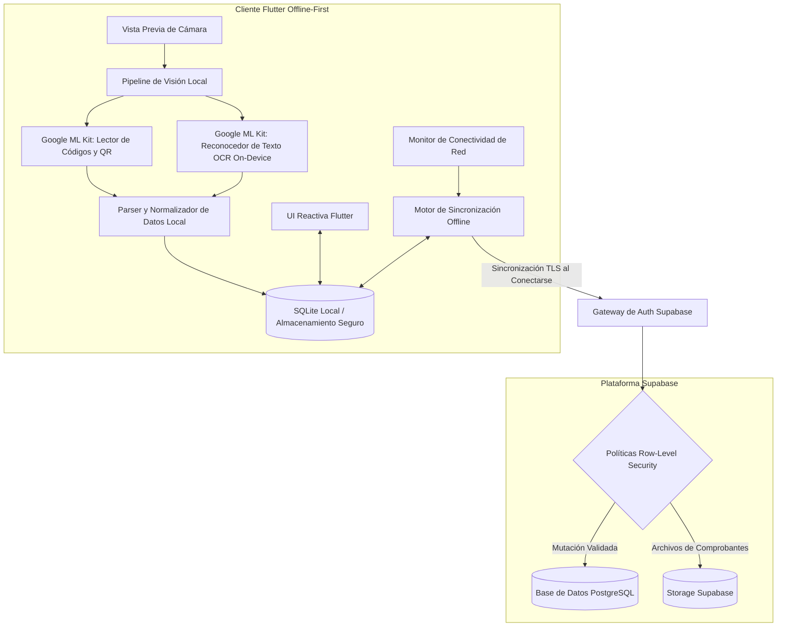

# umi: Visión en el Edge Offline-First y Procesamiento de Documentos

## Problema

Las operaciones de campo en logística, depósitos y verificación de inventario suelen desarrollarse en entornos físicos con conectividad celular intermitente o inexistente (por ejemplo, subsuelos de almacenamiento, galpones de carga y centros de distribución remotos). Las arquitecturas móviles tradicionales que delegan el escaneo de imágenes, la decodificación de códigos de barras y la extracción OCR a APIs en la nube provocan una gran fricción operativa: altas tasas de error, frustración en los operarios ante desconexiones y latencias impredecibles.

umi fue desarrollado como un MVP móvil offline-first en Flutter, combinando percepción computacional instantánea en el dispositivo con sincronización garantizada cuando la conectividad se restablece.

---

## Restricciones

1. **Ejecución Determinista Offline**: La lectura de códigos de barras/QR y la extracción de texto en formularios o comprobantes deben realizarse en el dispositivo sin depender de llamadas de red.
2. **Experiencia de Usuario Fluida Multiplataforma**: La interfaz debe sostener 60 FPS estables en un amplio abanico de dispositivos Android e iOS mientras se procesan los modelos de visión en el edge.
3. **Confidencialidad de Datos Multitenant**: Al reconectarse a la red, la sincronización de datos debe respetar fronteras estrictas de acceso por usuario y organización en el backend.
4. **Sincronización Resiliente en Segundo Plano**: El estado registrado en modo desconectado debe encolarse de manera determinista, deduplicarse y sincronizarse contra la base de datos en la nube sin inconsistencias de concurrencia.

---

## Arquitectura

El siguiente diagrama presenta la arquitectura edge offline-first y la sincronización con el backend en umi:

---

## Decisiones Clave y Trade-offs

- **Flutter para Desarrollo Ágil Multiplataforma**:
  - *Decisión*: Se seleccionó Flutter y Dart para unificar la base de código entre iOS y Android, aprovechando el renderizado reactivo y los componentes nativos de interfaz.
  - *Trade-off*: Incrementó ligeramente el tamaño inicial del binario frente a aplicaciones nativas puras, beneficio compensado con la reducción a la mitad del esfuerzo de mantenimiento.
- **Visión Computacional On-Device Mediante Google ML Kit**:
  - *Decisión*: Se integraron las librerías de inferencia local de Google ML Kit para escaneo de códigos de barra/QR y OCR directamente sobre el procesador del teléfono.
  - *Trade-off*: Menor margen de personalización frente a modelos propios entrenados desde cero, logrando tiempos de respuesta óptimos (<50 ms en códigos, <120 ms en texto) con cero dependencia de red.
- **Base Local SQLite con Patrón Outbox**:
  - *Decisión*: Se diseñó un registro transaccional en el almacenamiento local. Cada captura o escaneo se guarda de forma inmediata, mientras un gestor en segundo plano procesa la cola de subida con reintentos automáticos.
  - *Trade-off*: Requirió definir reglas explícitas de resolución de conflictos, asegurando una experiencia completamente tolerante a pérdidas de señal.
- **Backend en Supabase con Row-Level Security (RLS)**:
  - *Decisión*: Se empleó Supabase PostgreSQL configurado con políticas granulares de seguridad a nivel de fila para gobernar el acceso a los registros sincronizados.
  - *Trade-off*: Trasladó la lógica de autorización desde el middleware de aplicación directamente hacia la base de datos, garantizando aislamiento estricto entre organizaciones.

---

## Enfoque de Seguridad

- **Row-Level Security (RLS) Estricto**: Todas las tablas de PostgreSQL aplican directivas RLS asociadas al identificador del usuario autenticado (`auth.uid()`), impidiendo lecturas o modificaciones cruzadas entre diferentes cuentas.
- **Persistencia Local Cifrada**: Los datos sensibles extraídos y los registros de auditoría locales se protegen utilizando claves administradas por Android Keystore y iOS Keychain.
- **Comunicaciones Basadas en Tokens Efímeros**: La sincronización cloud opera mediante tokens JWT de vida corta gestionados por Supabase Auth; ninguna credencial maestra de base de datos se almacena en el cliente móvil.
- **Procesamiento de Imágenes sin Egresos Innecesarios**: El escaneo se procesa y transforma en datos estructurados en el propio dispositivo; las imágenes pesadas no se suben al servidor salvo requerimiento explícito de auditoría.

---

## Stack Tecnológico

- **Cliente Móvil**: Flutter, Dart
- **Percepción Computacional en el Dispositivo**: Google ML Kit (Barcode Scanning, On-Device OCR)
- **Persistencia Local**: SQLite, Secure Storage
- **Infraestructura de Backend**: Supabase (PostgreSQL, Row-Level Security, Autenticación, Object Storage)

---

## Qué Haría a Continuación

1. **Resolución de Conflictos Offline Basada en CRDTs**: Reemplazar la cola transaccional secuencial por Conflict-Free Replicated Data Types (CRDTs) para habilitar sincronización descentralizada entre dispositivos en el terreno.
2. **Corrección de Perspectiva en el Edge**: Implementar un modelo ligero on-device para enderezar y desangular comprobantes arrugados antes de pasarlos por el motor OCR de ML Kit.
3. **Cifrado de Extremo a Extremo en Datos Sensibles (E2EE)**: Incorporar cifrado de sobre en el cliente antes de la sincronización en la nube, garantizando confidencialidad incluso ante administradores de base de datos.
