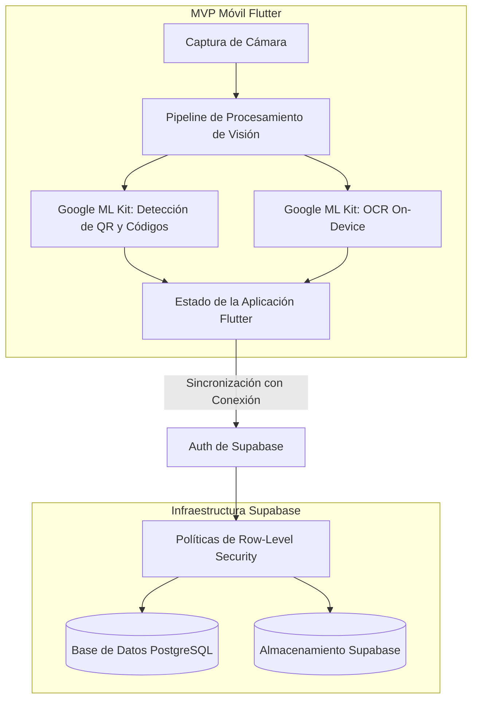

# umi: Visión en el Edge Offline-First y Procesamiento de Documentos

## Problema

Las operaciones móviles en campo suelen llevarse a cabo en zonas con conectividad de red limitada o intermitente. Las aplicaciones convencionales que dependen de endpoints en la nube para decodificar códigos QR y realizar reconocimiento óptico de caracteres (OCR) sufren retrasos y errores cuando la conexión se degrada.

umi fue creado como un MVP móvil multiplataforma en Flutter diseñado para realizar extracción de documentos y lectura de códigos de barras directamente en el dispositivo, sin depender de llamadas remotas a APIs.

---

## Restricciones

1. **Visión On-Device**: La decodificación de códigos de barras y QR junto con el reconocimiento de texto OCR deben ejecutarse directamente en el dispositivo móvil.
2. **Cliente Multiplataforma**: La aplicación móvil debe funcionar en iOS y Android a partir de una única base de código.
3. **Seguridad Multitenant**: Los datos sincronizados con el backend en la nube deben respetar las fronteras entre organizaciones y usuarios.

---

## Arquitectura

El siguiente diagrama presenta la arquitectura de componentes de la aplicación móvil umi y su backend:

---

## Decisiones Clave y Trade-offs

- **Flutter para el Desarrollo del MVP Móvil**:
  - *Decisión*: Se desarrolló la aplicación con Flutter y Dart para dar soporte tanto a iOS como a Android desde una base de código compartida.
  - *Trade-off*: Aumenta el tamaño inicial del instalable respecto a compilaciones nativas puras, reduciendo significativamente los tiempos de desarrollo para el MVP.
- **Visión On-Device Mediante Google ML Kit**:
  - *Decisión*: Se integraron las librerías on-device de Google ML Kit para la lectura de códigos de barra/QR y el reconocimiento de texto OCR.
  - *Trade-off*: Depende de modelos móviles preconstruidos en lugar de arquitecturas de visión entrenadas a medida, evitando latencias de red durante el escaneo.
- **Supabase con Row-Level Security (RLS)**:
  - *Decisión*: Se utilizó Supabase como backend aplicando políticas de Row-Level Security en las tablas de la base de datos.
  - *Trade-off*: Requiere administrar reglas de autorización dentro de las políticas de la base de datos, asegurando fronteras de acceso consistentes en la capa de datos.

---

## Enfoque de Seguridad

- **Row-Level Security (RLS)**: Las tablas de PostgreSQL implementan políticas de Row-Level Security en Supabase, limitando el acceso de lectura y escritura a usuarios autenticados según reglas de autorización.
- **Ejecución Local de Visión**: La lectura de QR y el OCR se realizan localmente mediante Google ML Kit; el procesamiento no requiere enviar video o fotos a servicios externos.
- **Sesiones Autenticadas**: La sincronización con el backend exige sesiones autenticadas gestionadas mediante Supabase Auth.

---

## Stack Tecnológico

- **Cliente Móvil**: Flutter, Dart
- **Visión On-Device**: Google ML Kit (Escaneo de Códigos de Barra, OCR On-Device)
- **Backend**: Supabase (PostgreSQL, Row-Level Security, Autenticación, Almacenamiento)

---

## Qué Haría a Continuación

1. **Tipos de Datos Replicados Libres de Conflicto (CRDTs)**: Idea a futuro: investigar estructuras CRDT para facilitar la sincronización de datos entre pares en situaciones de desconexión en el terreno.
2. **Corrección de Perspectiva de Documentos**: Idea a futuro: evaluar la incorporación de una etapa on-device para enderezar documentos torcidos antes del procesamiento OCR.
3. **Cifrado de Carga Útil Extremo a Extremo**: Idea a futuro: explorar el cifrado en el dispositivo de los datos sensibles sincronizados antes de su transmisión al backend.
