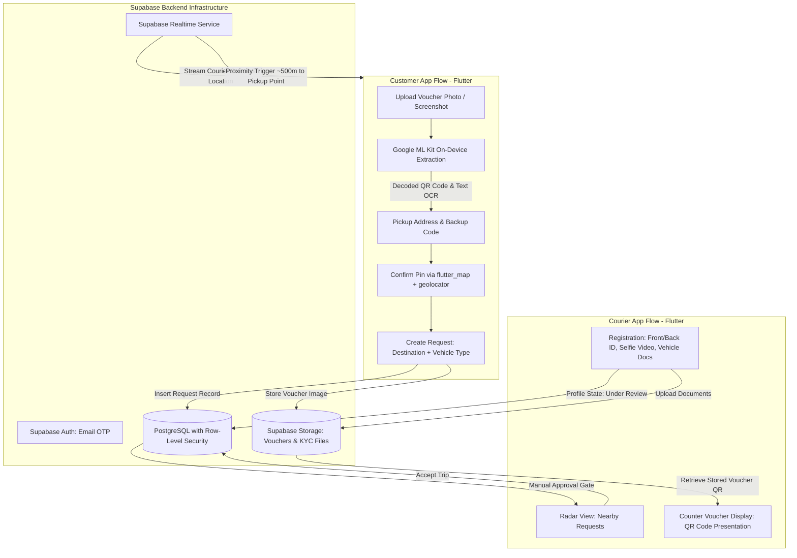

# umi: Last-Mile Pickup Delegation

## Problem

E-commerce deliveries frequently route packages to parcel pickup points rather than individual doorsteps. For customers unable to collect their parcels in person, coordinating third-party collection requires delegating pickup authority. Conventional courier or ride-hailing services operate as generic point-to-point delivery networks and lack the identity controls and authorization mechanisms required to pick up held packages securely on behalf of a recipient.

umi was built as a Flutter MVP (Android-first, closed testing) designed as a secure authorization bridge with chain of custody for last-mile pickup delegation, allowing customers to delegate pickup at e-commerce parcel pickup points to verified couriers.

---

## Constraints

1. **Authorization Bridge Focus**: The application is positioned strictly as a secure authorization bridge with chain of custody rather than a generic A-to-B transport service.
2. **On-Device Voucher Extraction**: Voucher QR decoding and text extraction from user-uploaded images must run directly on-device without external vision processing calls.
3. **Rigorous Courier Vetting**: Courier accounts must undergo identity and document verification before being allowed to view or accept pickup requests.
4. **Targeted Deployment**: Mobile MVP developed with an Android-first focus for closed testing environments.

---

## Architecture

The following diagram illustrates the interaction between customer requests, on-device parsing, courier onboarding, and Supabase backend services:

---

## Key Decisions & Trade-offs

- **On-Device Extraction via Google ML Kit**:
  - *Decision*: Executed QR code decoding and text recognition (OCR) on-device using Google ML Kit to extract pickup-point addresses and backup codes directly from voucher screenshots or photos.
  - *Trade-off*: Adds library footprint to the mobile client, but processes sensitive voucher images locally without intermediate remote vision API dependencies.
- **Persistent Voucher QR Lifecycle**:
  - *Decision*: Relied on the fact that e-commerce pickup point voucher QR codes remain valid while the parcel is held at the counter, storing the voucher in Supabase Storage and presenting it directly to the courier at pickup time.
  - *Trade-off*: Avoids complex short-lived token synchronization or dynamic push choreography at the physical counter, significantly simplifying system architecture.
- **Manual Courier KYC Approval Gate**:
  - *Decision*: Required aspiring couriers to submit identity documents (front and back ID photos, short selfie video, vehicle documents) and held accounts in an "under review" state until manual administrative approval.
  - *Trade-off*: Introduces an operational verification step prior to courier activation, ensuring that only vetted operators access the dispatch radar.
- **High-Contrast Dark UI with Neon Accents**:
  - *Decision*: Designed the mobile client with a high-contrast dark theme highlighted by neon accents.
  - *Trade-off*: Adheres to a distinct visual language rather than platform-default styling, reducing glare and eye strain during outdoor operations while lowering battery draw on OLED screens during long shifts.

---

## Security Approach

- **Row-Level Security (RLS)**: PostgreSQL tables enforce Row-Level Security policies in Supabase, restricting access to pickup requests, location updates, and operational records to authorized roles and assigned parties.
- **Isolated KYC and Voucher Storage**: Identity verification files (IDs, selfie videos, vehicle documents) and customer pickup vouchers are stored in dedicated Supabase Storage buckets bounded by access control rules.
- **Authentication via Email OTP**: Application authentication is managed through Supabase Auth utilizing one-time password (OTP) email verification.
- **On-Device Vision Boundary**: Voucher images are parsed locally on the customer's device with Google ML Kit to read barcodes and textual backup codes before request submission.

---

## Stack

- **Mobile Client**: Flutter, Dart (Android-first, closed testing)
- **On-Device Vision**: Google ML Kit (Barcode Scanning, On-Device Text Recognition / OCR)
- **Mapping & Location**: `flutter_map`, `geolocator`
- **Backend & Database**: Supabase (PostgreSQL, Row-Level Security)
- **Authentication & Realtime**: Supabase Auth (Email OTP), Supabase Realtime
- **Object Storage**: Supabase Storage (Vouchers, KYC Files)

---

## What I'd Do Next

1. **Automated Document Verification Pipeline**: Future idea: evaluate integrating automated document authenticity verification to assist manual KYC review.
2. **Proximity Geofencing Optimizations**: Future idea: investigate hardware-assisted background geofencing to optimize battery consumption during proximity alerts.
3. **Multi-Platform iOS Adaptation**: Future idea: assess adaptations for iOS devices following Android-first closed testing validation.
