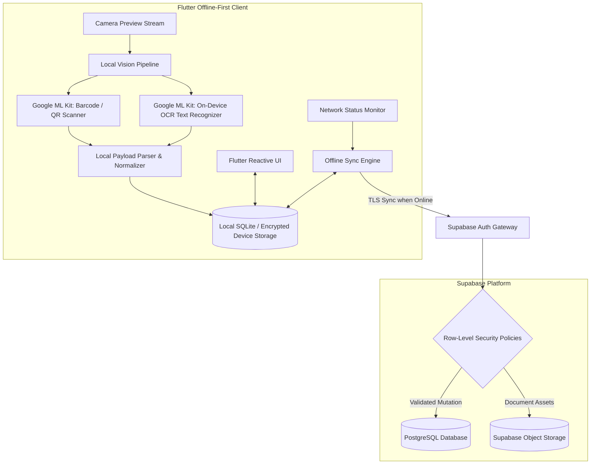

# umi: Offline-First Edge Vision & Document Processing

## Problem

Field operations in logistics, warehousing, and inventory verification frequently take place in physical environments with intermittent or non-existent cellular network connectivity (e.g., deep warehouse basements, transit depots, and rural shipping points). Traditional mobile architectures that offload image scanning, barcode decoding, and OCR document extraction to cloud APIs suffer severe operational friction: high failure rates, user frustration during connection drops, and unpredictable latency.

umi was engineered as an offline-first mobile MVP built in Flutter, delivering instantaneous local machine perception alongside guaranteed data synchronization when network connectivity resumes.

---

## Constraints

1. **Deterministic Offline Execution**: Barcode/QR scanning and text extraction from forms and receipts must execute locally on the mobile device without network roundtrips.
2. **Smooth Cross-Platform User Experience**: The interface must maintain 60 FPS fluidity across diverse iOS and Android hardware tiers while executing on-device vision inference.
3. **Multi-Tenant Data Confidentiality**: Once connectivity is restored, incoming synchronized data must enforce strict per-tenant and per-user access boundaries within the backend.
4. **Resilient Background Synchronization**: Local state captured while disconnected must be queued deterministically, deduplicated, and synced against the cloud datastore without causing data collisions.

---

## Architecture

The following diagram illustrates the offline-first edge architecture and backend synchronization of the umi application:

---

## Key Decisions & Trade-offs

- **Flutter for Cross-Platform Edge Delivery**:
  - *Decision*: Adopted Flutter with Dart to maintain a unified codebase for iOS and Android, leveraging Flutter's reactive widget tree and canvas rendering for rapid UI development.
  - *Trade-off*: Slightly increased initial application binary size compared to platform-native code, compensated by halving implementation and maintenance effort.
- **On-Device Vision via Google ML Kit**:
  - *Decision*: Integrated Google ML Kit's local inference libraries for QR/barcode scanning and OCR document extraction directly on the device.
  - *Trade-off*: Limited model customizability compared to custom PyTorch models, but gained production-grade recognition latency (<50 ms for barcodes, <120 ms for text) with zero cloud network dependency.
- **Local SQLite Store with Outbox Pattern**:
  - *Decision*: Designed an offline transaction journal in local storage. All camera captures and scans write immediately to local state, while an asynchronous sync manager handles batch synchronization with retry queues.
  - *Trade-off*: Required manual conflict resolution rules for concurrent updates, but enabled a 100% offline-tolerant user experience.
- **Supabase Backend with Row-Level Security (RLS)**:
  - *Decision*: Utilized Supabase PostgreSQL backed by granular Row-Level Security policies to protect synchronized document records.
  - *Trade-off*: Shifted authorization rules from application middleware directly into database policies, ensuring strict multi-tenant isolation regardless of the client access path.

---

## Security Approach

- **Strict Row-Level Security (RLS)**: All PostgreSQL tables enforce RLS rules linked to authenticated user identifiers (`auth.uid()`), ensuring users cannot read, write, or enumerate operational records belonging to other tenants.
- **Encrypted Local Persistence**: Scanned document text and operational logs written to the mobile device are protected using secure on-device storage keys backed by the Android Keystore and iOS Keychain.
- **Tokenized API Communication**: Cloud synchronization exclusively uses short-lived JWT tokens obtained from Supabase Auth; sensitive database credentials never exist within client binaries.
- **No Remote Image Offloading**: Document scans are parsed entirely into structured text on-device; raw high-resolution images are kept local unless explicit audit synchronization is commanded.

---

## Stack

- **Mobile Client**: Flutter, Dart
- **Edge Machine Perception**: Google ML Kit (Barcode Scanning, On-Device OCR)
- **Local Persistence**: SQLite, Secure Storage
- **Backend Infrastructure**: Supabase (PostgreSQL, Row-Level Security, Authentication, Object Storage)

---

## What I'd Do Next

1. **CRDT-Based Offline Conflict Resolution**: Replace the sequential outbox pattern with Conflict-Free Replicated Data Types (CRDTs) to allow seamless peer-to-peer field synchronization without a central coordinator.
2. **Fine-Tuned Edge Document Rectification**: Deploy a compact on-device perspective-correction model to un-warp distorted receipt scans before passing them to the ML Kit OCR engine.
3. **End-to-End Field Encryption (E2EE)**: Implement client-side envelope encryption for proprietary document payloads prior to cloud sync, ensuring zero plaintext visibility even to database administrators.
