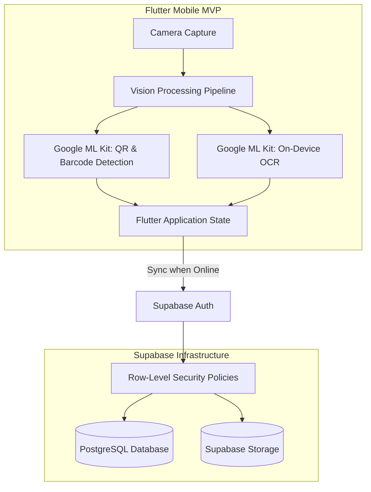

# umi: On-Device Vision & Document Processing

## Problem

Field operations in mobile environments often occur in areas with limited or intermittent network connectivity. Standard applications that rely on remote cloud endpoints to decode QR codes and perform Optical Character Recognition (OCR) experience delays and failures when network access is degraded.

umi was created as a cross-platform mobile MVP in Flutter designed to perform on-device document extraction and barcode reading without relying on remote API roundtrips.

---

## Constraints

1. **On-Device Vision**: Barcode and QR decoding and OCR text extraction must run directly on the mobile device.
2. **Cross-Platform Client**: The mobile client must support iOS and Android from a shared codebase.
3. **Multi-Tenant Security**: Data synchronized with the cloud backend must respect tenant and user boundaries.

---

## Architecture

The following diagram illustrates the component architecture of the umi mobile application and backend:

---

## Key Decisions & Trade-offs

- **Flutter for MVP Mobile Development**:
  - *Decision*: Built the application using Flutter and Dart to target both iOS and Android from a single codebase.
  - *Trade-off*: Increases base binary size compared to pure native builds, but reduces cross-platform development time for the MVP.
- **On-Device Vision via Google ML Kit**:
  - *Decision*: Integrated Google ML Kit on-device libraries for barcode/QR reading and OCR text recognition.
  - *Trade-off*: Relies on pre-built mobile models rather than custom trained vision architectures, but avoids roundtrip network latency during scanning.
- **Supabase with Row-Level Security (RLS)**:
  - *Decision*: Backed the application with Supabase and enforced Row-Level Security policies on database tables.
  - *Trade-off*: Requires managing authorization rules within database policies, but enforces access boundaries consistently at the data layer.

---

## Security Approach

- **Row-Level Security (RLS)**: PostgreSQL tables enforce Row-Level Security policies in Supabase, restricting record read and write access to authenticated users based on authorization rules.
- **Local Vision Execution**: QR reading and OCR run locally via Google ML Kit; frame processing does not require uploading raw footage to external services.
- **Authenticated Sessions**: Backend synchronization requires authenticated sessions managed through Supabase Auth.

---

## Stack

- **Mobile Client**: Flutter, Dart
- **On-Device Vision**: Google ML Kit (Barcode Scanning, On-Device OCR)
- **Backend**: Supabase (PostgreSQL, Row-Level Security, Authentication, Storage)

---

## What I'd Do Next

1. **Local Conflict-Free Replicated Data Types (CRDTs)**: Future idea: investigate CRDT structures to facilitate peer-to-peer data synchronization in disconnected field scenarios.
2. **Document Perspective Correction**: Future idea: explore adding an on-device edge detection step to straighten skewed documents before OCR processing.
3. **End-to-End Payload Encryption**: Future idea: explore encrypting sensitive synchronized payload fields on-device prior to backend transmission.
