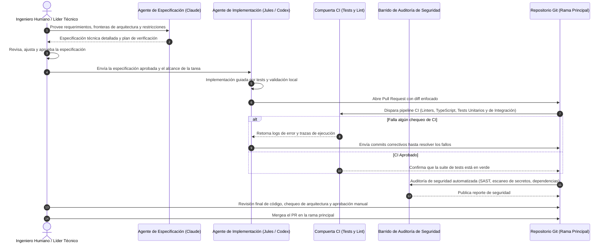

# Flujo de Desarrollo Agéntico: Ingeniería Human-in-the-Loop

## Visión General

El desarrollo de software contemporáneo puede alcanzar una velocidad sin precedentes aprovechando agentes de IA especializados. Sin embargo, la generación de código automatizada sin restricciones suele provocar degradación arquitectónica, dependencias inventadas, riesgos de regresión y fallas de seguridad.

Este documento formaliza la **Metodología de Desarrollo Agéntico Human-in-the-Loop** implementada en mis proyectos. En este esquema, los agentes autónomos actúan como multiplicadores de fuerza bajo directivas arquitectónicas rigurosas, compuertas automatizadas de testing, auditorías proactivas de seguridad y supervisión humana obligatoria antes de que el código llegue a producción.

---

## Ciclo de Vida del Flujo de Trabajo

El proceso separa el diseño conceptual, la implementación, la verificación y el despliegue en etapas bien delimitadas con puntos de control claros:

---

## Detalle de las Etapas

### 1. Especificación y Arquitectura (Claude)

- **Rol**: Razonamiento de alto nivel, descomposición modular del sistema y anticipación de casos límite (edge cases).
- **Artefacto**: Un documento formal de especificación que delimita:
  - Entradas, salidas y contratos de tipos exactos.
  - Reglas de negocio e invariantes del sistema.
  - Plan de tests paso a paso cubriendo condiciones de falla y límites.
- **Compuerta Humana**: El ingeniero analiza, ajusta y autoriza la especificación técnica antes de escribir cualquier línea de código de implementación.

### 2. Implementación Autónoma (Jules / Antigravity / Codex)

- **Rol**: Agente de programación asistido por herramientas operando en un entorno de ejecución aislado (sandbox).
- **Disciplina Operativa**:
  - **Desarrollo Clean-Room**: La implementación respeta estrictamente la arquitectura aprobada; sin funcionalidades especulativas no solicitadas.
  - **Verificación Guiada por Tests**: Cada funcionalidad se acompaña de sus correspondientes pruebas unitarias y de integración.
  - **Validación Local con Herramientas**: El agente ejecuta suites de pruebas, linters y comprobadores de tipos antes de presentar sus cambios.
- **Artefacto**: Un Pull Request atómico que incluye código fuente, tests y un resumen estructurado.

### 3. Compuerta Automatizada de Verificación en CI

- **Rol**: Filtro de calidad innegociable ejecutado en runners de CI efímeros.
- **Controles**:
  - Análisis estático completo y cumplimiento de linters (`npm run lint`).
  - Validación estricta de tipos (`tsc --noEmit`).
  - Ejecución de suites unitarias y pruebas de contrato de integración.
- **Política**: Ningún pull request puede mergearse si algún chequeo automatizado falla o fue omitido.

### 4. Barridos de Seguridad Periódicos y Previos al Merge

- **Rol**: Defensa proactiva frente a vulnerabilidades en la cadena de suministro, filtración de credenciales y patrones de código inseguros.
- **Auditorías**:
  - **Detección de Secretos**: Escaneo exhaustivo en busca de claves de API, tokens o archivos de entorno expuestos por error.
  - **SAST (Static Application Security Testing)**: Búsqueda de vectores de inyección (SQL, comandos del sistema, prompt injection, prototype pollution).
  - **Integridad de Dependencias**: Barridos automáticos periódicos para identificar vulnerabilidades en librerías transitivas.

### 5. Revisión Humana Final y Merge

- **Rol**: Gobernanza y criterio de ingeniería en manos de una persona.
- **Responsabilidades**:
  - Validar que la solución mantenga coherencia con la visión a largo plazo del sistema.
  - Comprobar que las abstracciones del modelo se mantengan limpias y legibles.
  - Realizar una inspección final antes de incorporar los cambios al tronco principal.

---

## Comparativa del Modelo Híbrido

| Dimensión | Generación Autónoma Pura | Ingeniería Manual Tradicional | Modelo Agéntico Human-in-the-Loop |
| :--- | :--- | :--- | :--- |
| **Velocidad** | Muy Rápida | Lenta a Moderada | **Rápida y Constante** |
| **Cohesión Arquitectónica** | Baja (alucinaciones, fragmentación) | Alta | **Alta (gobernada por especificación humana)** |
| **Postura de Seguridad** | Baja (vulnerabilidades desapercibidas) | Variable | **Muy Alta (múltiples capas de auditoría)** |
| **Rigor en Tests** | Frecuentemente ignorado | Variable | **Alto (los tests son compuertas estrictas)** |
| **Foco del Ingeniero** | Depurar salidas rotas de la IA | Escribir código repetitivo | **Arquitectura de sistemas y diseño clave** |
