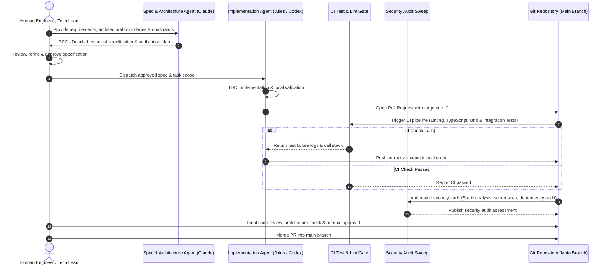

# Agentic Development Workflow: Human-in-the-Loop Engineering

## Overview

Modern software development can achieve unprecedented velocity by leveraging specialized AI agents. However, unconstrained automated code generation often leads to architectural drift, hallucinated dependencies, regression risks, and security vulnerabilities.

This document formalizes the **Human-in-the-Loop Agentic Development Workflow** utilized across my projects. In this model, autonomous agents act as force multipliers under strict architectural guardrails, automated test verification gates, proactive security audits, and mandatory human review before any code reaches production.

---

## Workflow Lifecycle

The process separates conceptual design, implementation, verification, and deployment into distinct stages with well-defined checkpoints:

---

## Stage Breakdown

### 1. Specification & Architecture (Claude)

- **Role**: High-level reasoning, system design decomposition, and edge-case anticipation.
- **Artifact**: A formal markdown specification document outlining:
  - Exact inputs, outputs, and interface types.
  - Invariant business rules and constraints.
  - Step-by-step test plan covering failure modes and edge cases.
- **Human Gate**: The engineer inspects and approves the specification prior to generating any implementation code.

### 2. Autonomous Implementation (Jules / Antigravity / Codex)

- **Role**: Tool-augmented coding agent operating in a sandboxed runtime.
- **Discipline**:
  - **Clean-Room Development**: Implementation adheres strictly to approved architecture; no speculative features.
  - **Test-Driven Verification**: New capabilities must be paired with unit and integration tests.
  - **Tool-Based Verification**: The agent runs local test suites, linters, and type checkers before proposing changes.
- **Artifact**: An atomic Pull Request containing source code, tests, and a structured summary.

### 3. Automated Test Verification Gate

- **Role**: Non-negotiable quality filter running on ephemeral CI runners.
- **Checks**:
  - Full static analysis and linter compliance (`npm run lint`).
  - Strict type checking (`tsc --noEmit`).
  - Fast-running unit test suites and contract integration tests.
- **Policy**: Pull requests cannot be merged if any automated check is failing or skipped.

### 4. Periodic & Pre-Merge Security Sweeps

- **Role**: Proactive defense against supply chain vulnerabilities, credential leaks, and insecure code patterns.
- **Audits**:
  - **Secret Detection**: Scans for accidental exposure of API keys, tokens, or environment artifacts.
  - **SAST (Static Application Security Testing)**: Scans for injection vectors (SQL, command, prompt injection, prototype pollution).
  - **Dependency Integrity**: Regular automated sweeps for vulnerable transitive dependencies.

### 5. Final Human Review & Merge Gate

- **Role**: Human-in-the-loop governance.
- **Responsibilities**:
  - Validates architectural alignment with long-term system vision.
  - Verifies that model abstractions and boundaries remain clean.
  - Executes final manual sanity checks before merging into the trunk.

---

## Key Benefits of the Hybrid Model

| Dimension | Pure Autonomous Generation | Traditional Manual Engineering | Human-in-the-Loop Agentic Model |
| :--- | :--- | :--- | :--- |
| **Velocity** | Very Fast | Slow to Moderate | **Fast & Consistent** |
| **Architectural Cohesion** | Low (hallucinations, fragmentation) | High | **High (governed by human spec)** |
| **Security Posture** | Low (unnoticed vulnerabilities) | Variable | **Very High (multi-layer automated sweeps)** |
| **Test Rigor** | Often neglected | Variable | **High (tests are strict merge gates)** |
| **Developer Focus** | Debugging agent outputs | Repetitive boilerplate | **System architecture & high-level design** |
